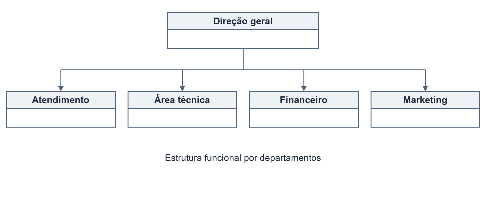
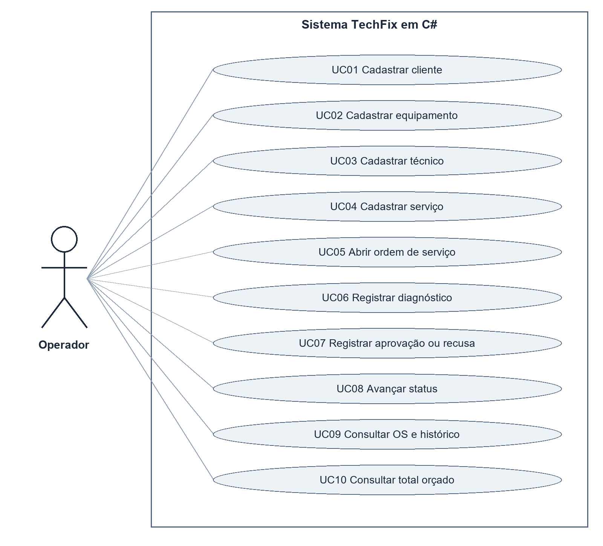
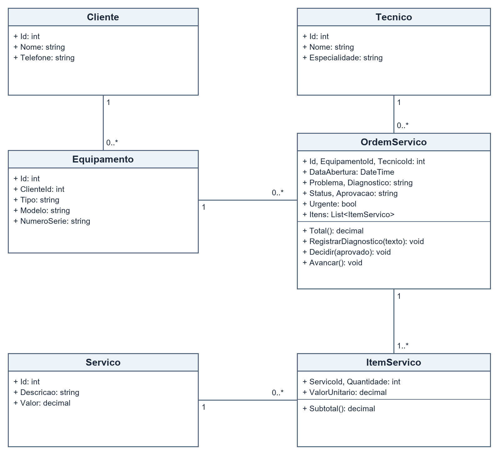
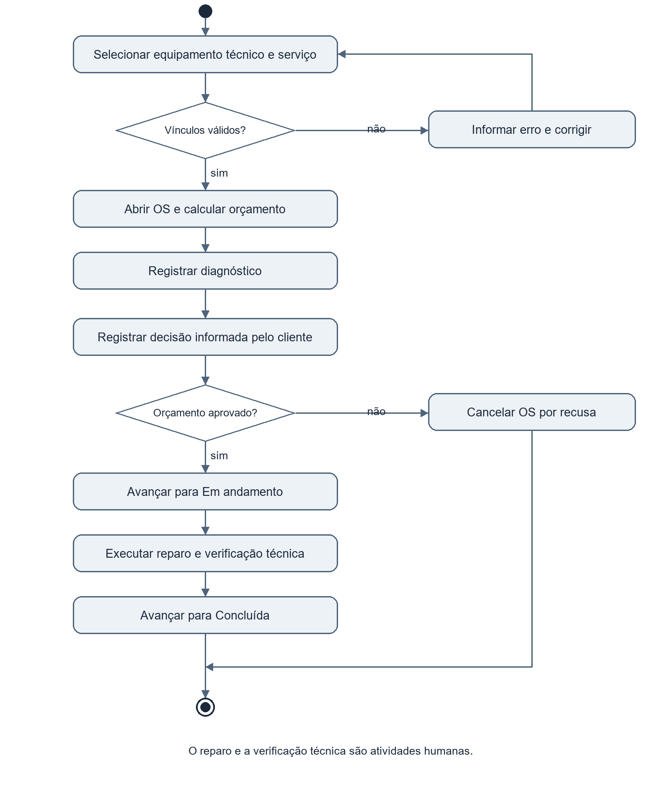
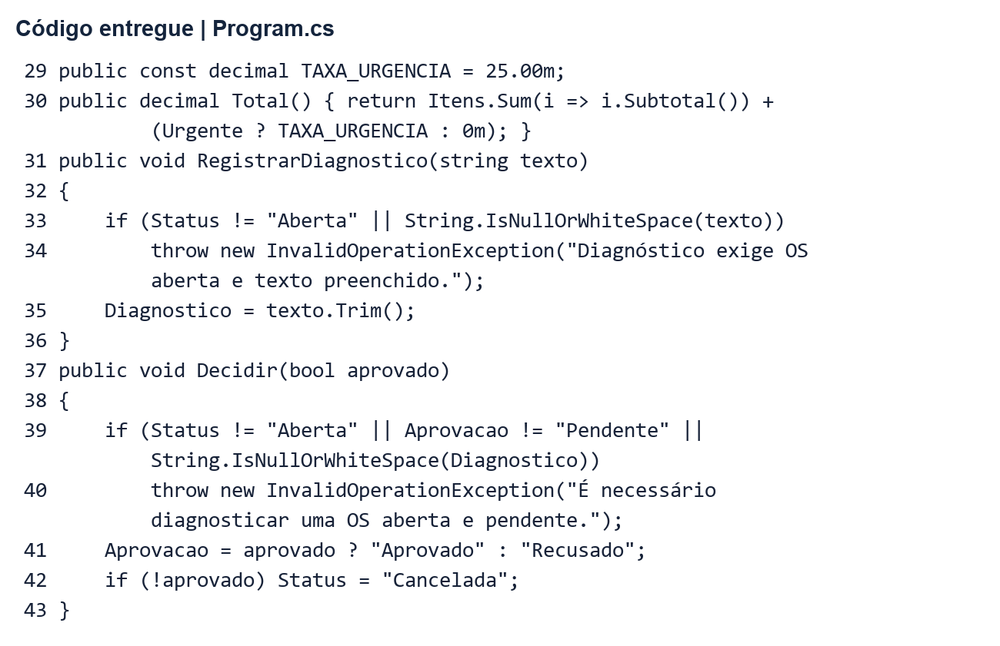
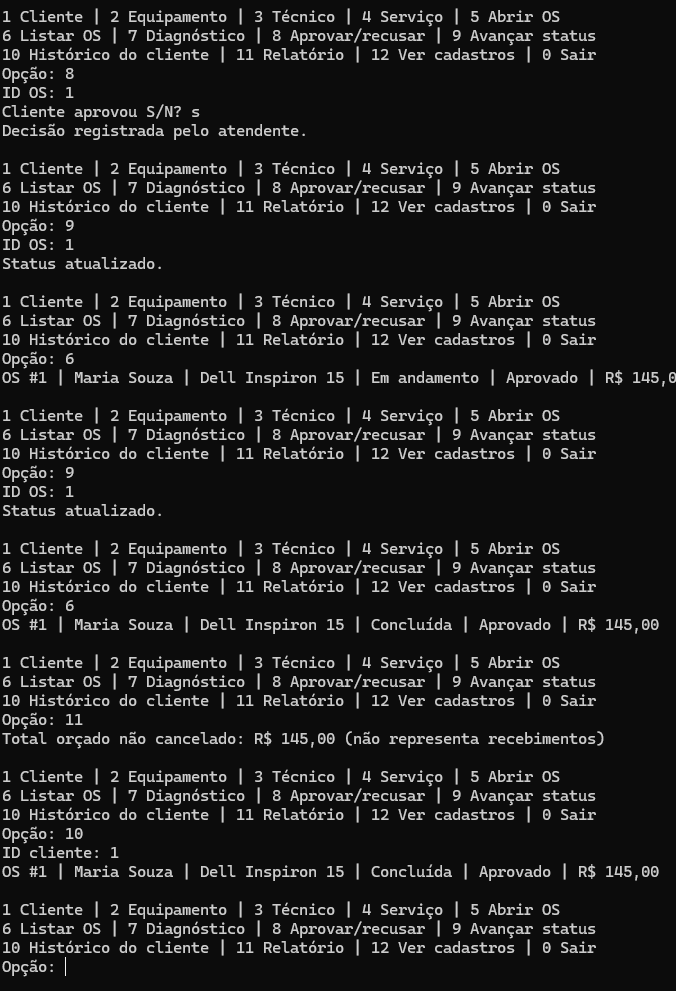
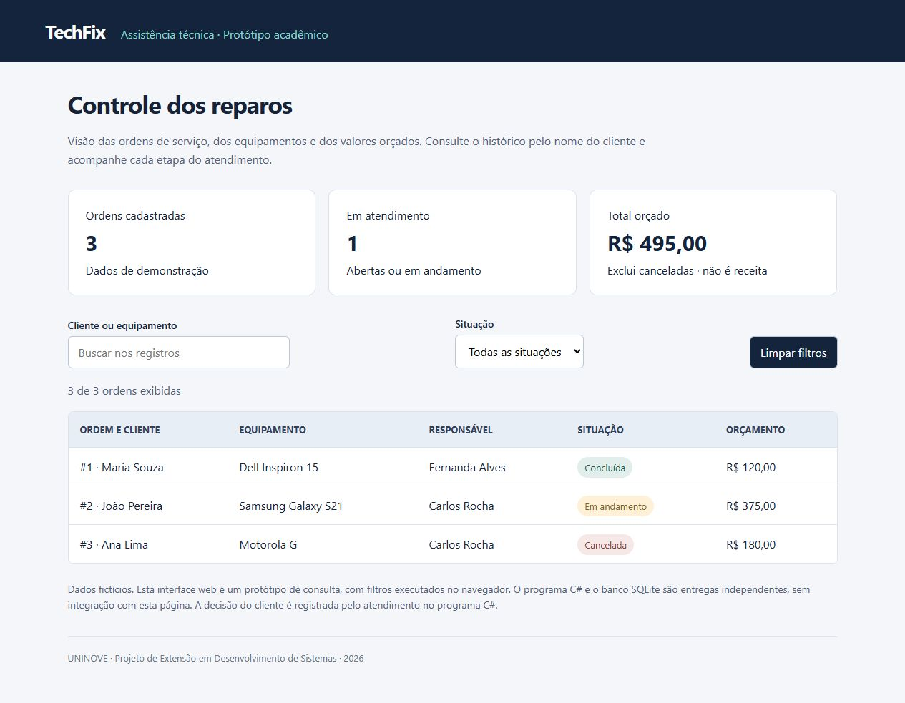
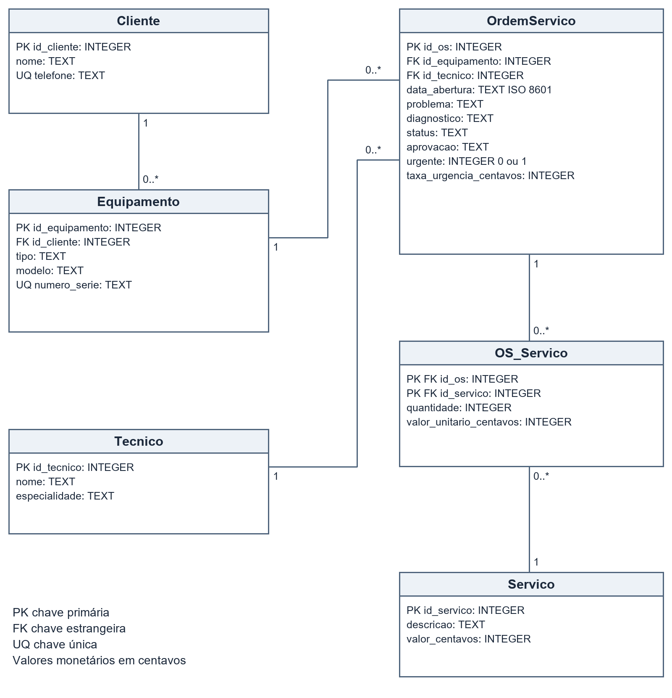
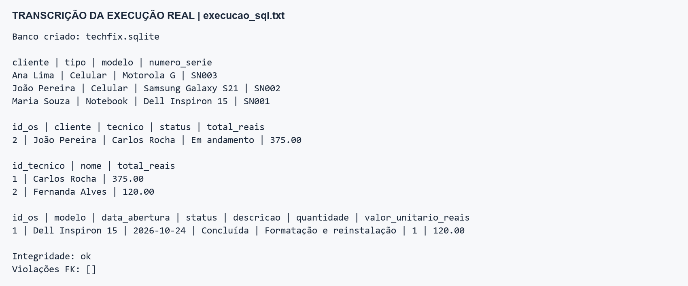

UNIVERSIDADE NOVE DE JULHO
DIRETORIA DOS CURSOS DE INFORMÁTICA

ELEN CAROLINA SOUZA DE AQUINO — RA 2224200303
EVELYN DE CARVALHO ROCHA — RA 2226200016
LEONARDO GOMES DE SOUSA — RA 2226106514
MATHEUS CARLOS DE OLIVEIRA — RA 2222200464
RODRIGO FRANÇA ALVES SANTANA — RA 2326202955
ROSILENE DO ESPÍRITO SANTO — RA 2226201088

PROJETO DE EXTENSÃO EM DESENVOLVIMENTO DE SISTEMAS
TECHFIX
Sistema de gestão para assistência técnica de computadores e celulares

SÃO PAULO
2026


ELEN CAROLINA SOUZA DE AQUINO — RA 2224200303
EVELYN DE CARVALHO ROCHA — RA 2226200016
LEONARDO GOMES DE SOUSA — RA 2226106514
MATHEUS CARLOS DE OLIVEIRA — RA 2222200464
RODRIGO FRANÇA ALVES SANTANA — RA 2326202955
ROSILENE DO ESPÍRITO SANTO — RA 2226201088

TECHFIX
Sistema de gestão para assistência técnica de computadores e celulares

Trabalho apresentado à Universidade Nove de Julho, UNINOVE, em cumprimento parcial às exigências da disciplina de Projeto de Extensão em Desenvolvimento de Sistemas, sob orientação da Prof. Priscilla Viana Cunha.

SÃO PAULO
2026

# RESUMO

O projeto TechFix apresenta uma solução acadêmica para organizar o atendimento de uma assistência técnica de computadores, notebooks e celulares. A proposta considera pessoas físicas e pequenos negócios que dependem desses equipamentos e precisam de informações claras sobre os reparos. O problema de partida é a dispersão de registros de clientes, equipamentos, diagnósticos e orçamentos, tratada como hipótese de demanda a ser validada com o público externo. O desenvolvimento utiliza o modelo incremental e reúne definição da equipe, estrutura organizacional, levantamento de requisitos, três diagramas UML e um banco de dados relacional com seis tabelas. O programa C# implementa cadastros, abertura de ordens de serviço, diagnóstico, decisão do cliente, controle de status, histórico e total orçado. Os dados do programa permanecem em memória, enquanto a implementação SQL é demonstrada independentemente em SQLite, conforme permitido pelo modelo da disciplina. Uma interface web local apresenta consultas sobre dados fictícios. Os testes verificaram regras de negócio, tratamento de entradas inválidas e restrições do banco, incluindo o bloqueio de reparos sem aprovação e a exclusão de ordens canceladas do total orçado. Os resultados demonstram o funcionamento técnico do protótipo, sem constituir comprovação de implantação ou impacto em uma comunidade. Os arquivos foram publicados em repositório público no GitHub. A gravação do pitch e a validação externa permanecem na etapa de finalização do grupo.

Palavras chave: assistência técnica; ordens de serviço; C#; UML; banco de dados.

# SUMÁRIO


O trabalho segue a estrutura do modelo da disciplina. Código C#, scripts SQL, base de demonstração, diagramas, interface web e registros de testes acompanham o relatório em pastas próprias. O roteiro de apresentação e o guia de finalização estão separados para facilitar a preparação da equipe.

# 1 OBJETIVOS DO PROJETO
## 1.1 Contexto e problema
Em uma assistência técnica, cada atendimento reúne contato do cliente, identificação do aparelho, relato do defeito, diagnóstico e valores previstos. Quando esses registros ficam separados, a equipe precisa localizar informações em fontes diferentes para responder ao cliente. A TechFix foi criada como empresa fictícia para representar esse cenário e desenvolver uma solução de controle de ordens de serviço.

O público beneficiário proposto inclui estudantes, trabalhadores autônomos, usuários domésticos e pequenos negócios. Como não foram fornecidos registros de entrevistas ou observação de campo, o problema é apresentado como hipótese de projeto e os benefícios são esperados, não medidos.
## 1.2 Objetivo geral
Desenvolver e demonstrar um protótipo para gerenciar ordens de serviço da TechFix, mantendo coerência entre requisitos, modelagem UML, programa C# e estrutura relacional do banco de dados.
## 1.3 Objetivos específicos
• Organizar clientes, equipamentos, técnicos e catálogo de serviços.
• Registrar problema, diagnóstico e decisão do cliente sobre o orçamento.
• Controlar os estados Aberta, Em andamento, Concluída e Cancelada.
• Calcular o orçamento com quantidade, preço histórico e taxa de urgência.
• Disponibilizar histórico por cliente e consultas entre as seis tabelas.
• Demonstrar as regras por testes reproduzíveis e um pitch de até dez minutos.
## 1.4 Delimitação
O escopo é acadêmico e local. Não abrange pagamentos, estoque de peças, emissão fiscal, acesso remoto de clientes, autenticação ou integração entre C#, página web e SQLite. Esses recursos podem compor uma evolução posterior, sem serem apresentados como funcionalidades disponíveis nesta entrega.

# 2 EQUIPE E PLANEJAMENTO
O grupo tem seis integrantes, dentro do intervalo de cinco a dez alunos exigido. A divisão abaixo foi confirmada para a finalização; responsabilidade principal não impede colaboração e revisão entre os membros.

| Integrante e RA | Papel | Responsabilidade |
|---|---|---|
| Leonardo Gomes de Sousa 2226106514 | Líder | Planejamento, dúvidas com a professora, controle e postagem única. |
| Rodrigo França Alves Santana 2326202955 | Análise e UML | Requisitos, diagramas e coerência dos modelos. |
| Elen Carolina Souza de Aquino 2224200303 | Banco de dados | DER, dicionário, criação SQL, dados e consultas. |
| Matheus Carlos de Oliveira 2222200464 | Programação C# | Cadastros, regras, menu e demonstração. |
| Evelyn de Carvalho Rocha 2226200016 | Documentação | Unificação, formatação, referências e revisão. |
| Rosilene do Espírito Santo 2226201088 | Testes e pitch | Verificação, evidências e coordenação da apresentação. |

## 2.1 Organização do trabalho
Cada responsável revisa sua frente e submete as alterações para conferência de outro integrante. O líder acompanha as pendências e reúne a versão que será entregue. A postagem no Classroom deve ser feita por um único aluno.

A parcial de 28 de setembro de 2026 já foi entregue, conforme informado pelo grupo. A entrega final foi informada pelo grupo para 3 de novembro de 2026; o horário limite deve ser conferido no Classroom.

# 2.2 Cronograma de referência
O quadro organiza o ciclo em semanas relativas. É um planejamento de referência, não uma comprovação das datas reais de execução. A equipe deve ajustar a finalização ao prazo confirmado pela professora.

| Semana | Atividade | Responsável | Entrega |
|---|---|---|---|
| S1 | Definir demanda e empresa | Todos | Público e escopo |
| S2 | Requisitos e objetivos | Rodrigo e Evelyn | RF e RNF |
| S3 | Organização e processo | Leonardo | Papéis e cronograma |
| S4 | Modelagem UML | Rodrigo | Três diagramas |
| S5 | Cadastros e abertura de OS | Matheus | Incremento 1 |
| S6 | Diagnóstico e acompanhamento | Matheus | Incremento 2 |
| S7 | Modelagem e estrutura SQL | Elen | Seis tabelas |
| S8 | Consultas e evidências | Elen e Rosilene | Testes e resultados |
| S9 | Revisão e validação externa | Evelyn e todos | Ajustes documentados |
| S10 | GitHub pitch e entrega | Leonardo e todos | Links e postagem |

## 2.3 Critérios de conclusão
Uma etapa termina quando seus arquivos existem, a explicação está no relatório e a evidência pode ser reproduzida. Funcionalidades exigem demonstração; diagramas exigem coerência com o sistema; publicações exigem verificação do link por outra pessoa.

A consolidação técnica foi realizada em 24 de outubro de 2026. Em 2 de novembro de 2026, os 48 arquivos do pacote foram publicados e conferidos no GitHub, com acesso público. Permanecem a gravação e publicação do pitch, as capturas nativas e a validação externa. O guia registra essas ações.

# 3 ESTRUTURA ORGANIZACIONAL
## 3.1 Caracterização da TechFix
A TechFix é uma assistência técnica fictícia de computadores, notebooks e celulares. Oferece diagnóstico, manutenção preventiva, reinstalação de software e troca de componentes. O sistema organiza os registros desses atendimentos, sem executar os reparos físicos ou substituir a avaliação profissional.
## 3.2 Missão visão e valores
Missão: oferecer manutenção com qualidade técnica, informação clara e responsabilidade no atendimento.

Visão: tornar-se uma referência local em organização, confiabilidade e transparência no acompanhamento dos reparos.

Valores: honestidade no diagnóstico; respeito ao cliente; cuidado com equipamentos e informações; cumprimento dos acordos; aprendizado contínuo; destinação responsável dos componentes substituídos.
## 3.3 Público e demanda extensionista
O público proposto reúne usuários domésticos, estudantes, autônomos e pequenos empreendedores. A necessidade a investigar é a dificuldade de acompanhar o orçamento e o andamento da manutenção quando os registros são dispersos.

Não foram apresentados registros de contato com uma assistência técnica ou aplicação comunitária. Não se afirma que a demanda já foi comprovada. O plano de validação prevê demonstrar o protótipo a um representante do público, observar uma tarefa de consulta e registrar dúvidas e sugestões com autorização do participante.
## 3.4 Benefícios esperados
Espera-se facilitar a localização da OS, tornar os valores previstos mais claros e evitar serviços sem aprovação registrada. A avaliação pode observar o tempo para localizar um atendimento, a compreensão do status e a capacidade de explicar o total. Não há percentual de melhoria ou satisfação medido nesta etapa.

# 3.5 Organograma funcional
A estrutura funcional reúne os departamentos sob uma direção geral. O organograma representa áreas da empresa fictícia; a tabela da equipe descreve os alunos responsáveis pelo projeto.



| Departamento | Função |
|---|---|
| Direção geral | Define prioridades, coordena a operação e acompanha a qualidade. |
| Atendimento | Mantém cadastros, recebe o relato e registra a decisão do cliente. |
| Área técnica | Realiza diagnóstico e reparo e informa o avanço da manutenção. |
| Financeiro | Acompanha orçamentos e custos; o protótipo não controla pagamentos. |
| Marketing | Divulga serviços e organiza a comunicação institucional. |

No C#, as ações são executadas por um operador local. A divisão dos departamentos descreve o negócio, sem representar permissões de acesso implementadas.

# 4 ENGENHARIA DE SOFTWARE E MODELAGEM
## 4.1 Modelo incremental
O modelo incremental organiza a construção em entregas sucessivas. Cada incremento percorre requisitos, análise, projeto, implementação e testes, acrescentando funcionalidades sobre uma base já verificada. A escolha permite priorizar os atendimentos essenciais e revisar conjuntos menores de mudanças.

| Incremento | Conteúdo | Aceite |
|---|---|---|
| 1 Cadastros e abertura | Clientes, equipamentos, técnicos, serviços e abertura de OS. | Vínculos válidos e campos obrigatórios. |
| 2 Acompanhamento | Diagnóstico, decisão, status e histórico. | Reparo bloqueado sem aprovação e cancelamento por recusa. |
| 3 Consulta e demonstração | Total, SQL, interface web e evidências. | Resultados conferidos e texto coerente. |

## 4.2 Aplicação das etapas
O levantamento consolidou as necessidades descritas nas versões iniciais. A análise delimitou o escopo e as regras de orçamento. O projeto representou casos de uso, classes, atividades e dados. A implementação gerou o programa e os scripts independentes. Os testes verificaram caminhos válidos e inválidos, e a disponibilização foi organizada em pastas reproduzíveis.
## 4.3 Coerência entre os modelos
OrdemServico reúne diagnóstico, aprovação, urgência e status. ItemServico guarda quantidade e preço histórico e corresponde à associação OS_Servico. O cliente não acessa o sistema: sua decisão é comunicada ao atendimento e registrada pelo operador.

A UML representa comportamento e estrutura do software; o DER descreve atributos persistidos, chaves e vínculos relacionais. O diagrama de classes não substitui o modelo de banco (OMG, 2017).

# 4.4 Requisitos funcionais
As operações abaixo estão disponíveis no programa C#. A associação ao menu permite demonstrá-las sem integração externa.

| Código | Operação | Descrição | Menu e caso |
|---|---|---|---|
| RF01 | Cadastrar cliente | Nome e telefone único. | 1 UC01 |
| RF02 | Cadastrar equipamento | Cliente existente e série única. | 2 UC02 |
| RF03 | Cadastrar técnico | Nome e especialidade. | 3 UC03 |
| RF04 | Cadastrar serviço | Descrição e preço não negativo. | 4 UC04 |
| RF05 | Abrir OS | Equipamento, técnico, serviço e quantidade. | 5 UC05 |
| RF06 | Registrar diagnóstico | Avaliação em OS aberta. | 7 UC06 |
| RF07 | Registrar decisão | Aprovar ou recusar após diagnóstico. | 8 UC07 |
| RF08 | Avançar status | Iniciar reparo aprovado e depois concluir. | 9 UC08 |
| RF09 | Consultar OS e histórico | Listagem geral ou filtro por cliente. | 6 e 10 UC09 |
| RF10 | Consultar total orçado | Somar OS não canceladas. | 11 UC10 |

O menu 12 apresenta os cadastros auxiliares para localizar os identificadores. A opção 0 encerra a sessão. Os modos de demonstração fornecem exemplos fictícios; o funcionamento padrão permite cadastrar os próprios registros.

# 4.5 Qualidade e regras de negócio
| Código | Requisito não funcional | Critério verificável |
|---|---|---|
| RNF01 | Usabilidade | Menu numerado, mensagens em português e saída explícita. |
| RNF02 | Confiabilidade | Entradas inválidas não encerram o menu; fim da entrada encerra a sessão. |
| RNF03 | Integridade | Campos e vínculos validados; chaves e restrições no SQL. |
| RNF04 | Manutenibilidade | Domínio e gestão separados do menu; comentários e testes. |

| Regra | Descrição |
|---|---|
| RN01 | A OS exige equipamento, técnico, serviço e quantidade de 1 a 1000. |
| RN02 | Total é a soma de quantidade × preço histórico, acrescida de R$ 25,00 uma vez quando urgente. |
| RN03 | Alterar o catálogo não muda o preço do item já registrado. |
| RN04 | Aprovar ou recusar exige OS aberta, decisão pendente e diagnóstico. |
| RN05 | A recusa cancela; a aprovação permite avançar para Em andamento e depois Concluída. |
| RN06 | OS concluída ou cancelada não pode ser reaberta pelo fluxo. |
| RN07 | O total exclui canceladas e representa orçamento, não receita. |

O cliente da OS é obtido pelo equipamento. A ordem não repete o identificador do cliente, evitando apontar para proprietário diferente daquele registrado no aparelho.

# 4.6 Diagrama de casos de uso


Operador representa a pessoa que utiliza o programa local, acumulando ações de atendimento, técnica e gestão para demonstração. Os dez casos correspondem aos dez requisitos. Não se usam include ou extend porque a decomposição não é necessária neste escopo. Autenticação e portal do cliente não estão implementados.

# 4.7 Especificação dos casos de uso
## UC05 Abrir ordem de serviço
Ator: Operador. Pré condições: cliente, equipamento, técnico e serviço cadastrados. Gatilho: opção 5 do menu.

Fluxo principal: consultar cadastros; informar equipamento e técnico; descrever problema; indicar urgência; selecionar serviço e quantidade; validar vínculos; criar a OS com status Aberta e decisão Pendente; apresentar o total.

Alternativas: identificador inexistente, campo vazio ou quantidade inválida são rejeitados antes da criação. O operador corrige as informações e executa novamente a opção. Pós condição: uma OS válida é incluída na sessão.
## UC07 Registrar aprovação ou recusa
Pré condições: OS aberta, decisão pendente e diagnóstico preenchido. O operador informa a OS e registra a decisão comunicada pelo cliente. Aprovar mantém a OS aberta e habilita o reparo; recusar define Cancelada. Não há assinatura eletrônica ou coleta direta da autorização do cliente.
## UC08 Avançar status
Uma OS aberta e aprovada avança para Em andamento; uma OS em andamento avança para Concluída. Outras transições são rejeitadas. A conclusão é registrada após reparo e verificação técnica, que são atividades humanas externas ao programa.
## UC09 Consultar ordens e histórico
O operador lista todas as ordens ou informa um cliente existente para obter apenas os atendimentos de seus equipamentos. A ausência de resultados é informada. O histórico do C# existe na sessão; a consulta SQL demonstra os registros persistidos no banco independente.

# 4.8 Diagrama de classes


Cliente possui zero ou mais equipamentos. Cada equipamento e técnico podem se relacionar com várias ordens. A OS criada pelo programa contém ao menos um ItemServico, ligado a um serviço do catálogo. OrdemServico concentra cálculo e transições; Gestao executa cadastros e valida vínculos. Os métodos de cadastro pertencem a Gestao, evitando atribuir às entidades operações que não existem no código. A figura representa o domínio, sem detalhar a interface de console.

# 4.9 Diagrama de atividades


O fluxo inclui rejeição e correção de vínculos inválidos, cálculo do orçamento e diagnóstico. A decisão do cliente separa o reparo do cancelamento. Enquanto não há decisão, a OS permanece Aberta e Pendente. O reparo é humano; o programa registra seus estados. A figura mostra o percurso após a comunicação da decisão ao operador.

# 5 SISTEMA EM LINGUAGEM C#
## 5.1 Funcionamento e arquitetura
A aplicação de console possui classes de domínio, operações de gestão e interface textual. Program mantém o menu e coleta entradas; Gestao mantém as listas e valida vínculos; OrdemServico calcula o total e controla diagnóstico, decisão e status.

As listas List<T> armazenam os dados na memória. Ao encerrar, os registros da sessão são perdidos. O SQLite é uma entrega independente, conforme permitido pelo exemplo da disciplina; não há persistência automática do console.
## 5.2 Elementos de lógica
| Elemento | Aplicação |
|---|---|
| Variáveis e constante | Identificadores, textos, quantidade e TAXA_URGENCIA de 25.00m. |
| Operadores | Multiplicação e soma no orçamento; comparações e operadores lógicos nas validações. |
| Decisão | switch encaminha opções; if e else validam dados e transições. |
| Repetição | do while mantém o menu; while repete leituras; for e foreach percorrem registros. |
| Menu | Opções 0 a 12 com permanência até a saída. |
| Organização | Identificação do grupo, comentários e indentação. |

## 5.3 Como executar
No Windows com .NET Framework, csharp/INICIAR.cmd compila o fonte e abre os cadastros fictícios. Com SDK .NET compatível, TechFix.csproj pode ser executado por dotnet run -- --demo. A compilação verificada nesta entrega usou o compilador .NET Framework 4 disponível no ambiente. A alternativa com SDK não foi executada aqui.

O modo --roteiro reproduz o cenário das evidências. Para demonstrar o menu, use --demo e abra uma nova OS. O modo normal, sem argumentos, inicia sem registros.

# 5.4 Código e cálculo do orçamento


O tipo decimal representa dinheiro. Total multiplica quantidade pelo preço guardado no item e soma a taxa quando urgente. A decisão e o avanço rejeitam estados incompatíveis.

A leitura monetária utiliza Decimal.TryParse, cultura pt BR, sem milhar e com até duas casas decimais. Texto inválido é rejeitado antes da operação (MICROSOFT, s.d.).
## 5.5 Exemplo numérico
Troca de tela de R$ 350,00 com quantidade 1 e urgência totaliza R$ 375,00. Reinstalação de R$ 120,00 sem urgência permanece em R$ 120,00. As duas OS somam R$ 495,00. Uma OS recusada de R$ 180,00 continua na listagem e é excluída desse total.

# 5.6 Evidências e testes do programa


Na sessão do grupo, a OS 1 de Maria Souza recebeu diagnóstico, aprovação e os estados Em andamento e Concluída. Serviço de R$ 120,00 e urgência de R$ 25,00 totalizaram R$ 145,00, conferidos no relatório e no histórico do cliente. As quatro capturas nativas estão na pasta evidencias.

É um cenário distinto do modo roteiro, que mantém três OS fictícias e R$ 495,00 não cancelados. Os registros anteriores preservam 21 testes de domínio e um cenário de entradas inválidas. A captura comprova uso local, sem representar validação com público externo.

# 5.7 Interface web e planejamento DevOps
A orientação geral inclui apresentação de sistema web e planejamento DevOps no pitch. O pacote oferece web/index.html como protótipo de consulta. A página apresenta as três OS fictícias, resumo dos valores, busca por cliente ou equipamento e filtro de situação. Não altera dados e não se conecta ao console ou ao banco.

web/ABRIR.cmd abre a página sem instalar dependências. A busca ignora acentos e maiúsculas; Limpar filtros restaura a listagem. As métricas representam o conjunto inteiro e os filtros afetam apenas as linhas. A busca sem acento, a combinação com Cancelada, o resultado vazio e a limpeza dos filtros foram verificados no navegador. A captura acompanha o pacote.
## 5.8 Versionamento e disponibilização
O projeto foi publicado em um repositório único com as pastas csharp, banco, diagramas, evidencias, web e documentacao. Cada alteração deve descrever seu objetivo, passar por revisão de outro integrante e gerar nova evidência quando mudar o comportamento.

| Etapa | Procedimento previsto |
|---|---|
| Versionar | Fontes, scripts, documentação e evidências publicados; preservar o histórico das próximas alterações. |
| Verificar | Compilar, executar os testes e conferir integridade e consultas SQL. |
| Revisar | Conferir texto, diagramas e instruções com outro integrante. |
| Distribuir | Identificar uma versão final e usar seus links no relatório. |
| Recuperar | Preservar a versão anterior no histórico para corrigir erros. |

O GitHub já está publicado e com acesso público. O quadro descreve o fluxo de revisão das próximas alterações. Não há integração contínua configurada nem hospedagem da interface web.

# 5.9 Evidência da interface web


A página exibe três ordens fictícias, uma em atendimento e R$ 495,00 em orçamento não cancelado. A verificação encontrou João Pereira pela busca joao, combinou esse termo com Cancelada e apresentou resultado vazio; Limpar filtros restaurou as três linhas. O registro está em evidencias/testes_web.txt.

A consulta local não publica informações na internet. Os dados fixos demonstram o conceito da interface, sem integração com as entregas de programação e banco.

# 6 MODELAGEM E BANCO DE DADOS
## 6.1 Escolha e organização
A implementação usa SQLite para demonstrar um banco local sem servidor dedicado. techfix.sqlite acompanha os scripts e contém dados fictícios. Essa escolha unifica os dialetos SQL diferentes dos rascunhos em uma implementação executada e conferida.

Valores monetários são inteiros em centavos: R$ 350,00 equivale a 35000. Os cálculos somam inteiros e a divisão por 100 é feita na apresentação, evitando armazenar dinheiro em ponto flutuante.
## 6.2 Dicionário de dados
| Entidade | Atributos e finalidade |
|---|---|
| Cliente | id_cliente PK, nome e telefone único. Identifica e permite contato. |
| Equipamento | id_equipamento PK, id_cliente FK, tipo, modelo e numero_serie único. Identifica o aparelho. |
| Tecnico | id_tecnico PK, nome e especialidade. Identifica o responsável. |
| Servico | id_servico PK, descricao e valor_centavos. Mantém o catálogo. |
| OrdemServico | id_os PK, id_equipamento e id_tecnico FKs, data_abertura, problema, diagnostico, status, aprovacao, urgente e taxa_urgencia_centavos. Controla o atendimento. |
| OS_Servico | PK composta por id_os e id_servico, ambos FKs; quantidade e valor_unitario_centavos. Preserva o preço do atendimento. |

## 6.3 Relacionamentos
Cliente tem zero ou muitos equipamentos; equipamento e técnico têm zero ou muitas OS. A associação N:N entre OS e serviço é resolvida por OS_Servico. Cada item referencia uma OS e um serviço. O SQL permite uma OS sem itens; o fluxo do programa garante ao menos um item.

PRAGMA foreign_keys = ON deve ser habilitado em cada conexão para aplicar os vínculos do SQLite (SQLITE, s.d.).

# 6.4 Diagrama entidade relacionamento


O modelo apresenta chaves e tipos para apoiar a implementação. O cliente é obtido pelo equipamento e o preço histórico permanece na associação ao serviço. A taxa é registrada uma vez na OS e acrescentada depois da soma dos itens.

# 6.5 Estrutura e integridade SQL
O script cria seis tabelas, chaves e índices em uma transação. PK identifica registros, FK exige referência existente, UNIQUE controla duplicidade e CHECK valida domínios. Quantidade e valores monetários exigem armazenamento inteiro.

```sql
PRAGMA foreign_keys = ON;
BEGIN;
CREATE TABLE Cliente (
 id_cliente INTEGER PRIMARY KEY,
 nome TEXT NOT NULL CHECK(length(trim(nome))>0),
 telefone TEXT NOT NULL UNIQUE CHECK(length(trim(telefone))>0)
);
CREATE TABLE Tecnico (
 id_tecnico INTEGER PRIMARY KEY,
 nome TEXT NOT NULL CHECK(length(trim(nome))>0),
 especialidade TEXT NOT NULL CHECK(length(trim(especialidade))>0)
);
CREATE TABLE Equipamento (
 id_equipamento INTEGER PRIMARY KEY,
 id_cliente INTEGER NOT NULL REFERENCES Cliente(id_cliente),
 tipo TEXT NOT NULL CHECK(length(trim(tipo))>0),
 modelo TEXT NOT NULL CHECK(length(trim(modelo))>0),
 numero_serie TEXT COLLATE NOCASE NOT NULL UNIQUE CHECK(length(trim(numero_serie))>0)
);
CREATE TABLE Servico (
 id_servico INTEGER PRIMARY KEY,
 descricao TEXT NOT NULL CHECK(length(trim(descricao))>0),
 valor_centavos INTEGER NOT NULL CHECK(typeof(valor_centavos)='integer' AND valor_centavos BETWEEN 0 AND 100000000)
);
```

Campos obrigatórios evitam registros vazios. O número de série é único sem distinção de maiúsculas. Os limites monetários e de quantidade correspondem às validações do programa.

# 6.6 Estrutura SQL das ordens e itens
```sql
CREATE TABLE OrdemServico (
 id_os INTEGER PRIMARY KEY,
 id_equipamento INTEGER NOT NULL REFERENCES Equipamento(id_equipamento),
 id_tecnico INTEGER NOT NULL REFERENCES Tecnico(id_tecnico),
 data_abertura TEXT NOT NULL CHECK(length(data_abertura)=10),
 problema TEXT NOT NULL CHECK(length(trim(problema))>0),
 diagnostico TEXT NOT NULL DEFAULT '',
 status TEXT NOT NULL DEFAULT 'Aberta' CHECK(status IN ('Aberta','Em andamento','Concluída','Cancelada')),
 aprovacao TEXT NOT NULL DEFAULT 'Pendente' CHECK(aprovacao IN ('Pendente','Aprovado','Recusado')),
 urgente INTEGER NOT NULL DEFAULT 0 CHECK(urgente IN (0,1)),
 taxa_urgencia_centavos INTEGER NOT NULL DEFAULT 0 CHECK(taxa_urgencia_centavos IN (0,2500)),
 CHECK((urgente=0 AND taxa_urgencia_centavos=0) OR (urgente=1 AND taxa_urgencia_centavos=2500)),
 CHECK((status IN ('Em andamento','Concluída') AND aprovacao='Aprovado') OR status IN ('Aberta','Cancelada')),
 CHECK((aprovacao='Recusado' AND status='Cancelada') OR aprovacao<>'Recusado'),
 CHECK(aprovacao='Pendente' OR length(trim(diagnostico))>0)
);
CREATE TABLE OS_Servico (
 id_os INTEGER NOT NULL REFERENCES OrdemServico(id_os),
 id_servico INTEGER NOT NULL REFERENCES Servico(id_servico),
 quantidade INTEGER NOT NULL CHECK(typeof(quantidade)='integer' AND quantidade BETWEEN 1 AND 1000),
 valor_unitario_centavos INTEGER NOT NULL CHECK(typeof(valor_unitario_centavos)='integer' AND valor_unitario_centavos BETWEEN 0 AND 100000000),
 PRIMARY KEY(id_os,id_servico)
);
CREATE INDEX idx_equipamento_cliente ON Equipamento(id_cliente);
CREATE INDEX idx_os_equipamento ON OrdemServico(id_equipamento);
CREATE INDEX idx_os_tecnico ON OrdemServico(id_tecnico);
CREATE INDEX idx_item_servico ON OS_Servico(id_servico);
COMMIT;
```

As restrições exigem diagnóstico para uma decisão e aprovação para os estados de reparo. Elas verificam o estado das linhas; a sequência de transições é controlada pelo C#, sem gatilhos ou histórico temporal no SQL.

A data é texto ISO com dez caracteres. O CHECK de comprimento não valida sozinho o calendário; os dados fictícios usam datas válidas. Não há exclusão em cascata.

# 6.7 Dados fictícios e execução
O script insere três clientes, três equipamentos, dois técnicos, três serviços, três OS e seus itens. O cenário corresponde ao modo roteiro do programa.

```sql
PRAGMA foreign_keys = ON;
BEGIN;
-- Dados inteiramente fictícios para demonstração acadêmica.
INSERT INTO Cliente VALUES (1,'Maria Souza','11988881234'),(2,'João Pereira','11977775678'),(3,'Ana Lima','11966664321');
INSERT INTO Tecnico VALUES (1,'Carlos Rocha','Hardware'),(2,'Fernanda Alves','Software');
INSERT INTO Equipamento VALUES
 (1,1,'Notebook','Dell Inspiron 15','SN001'),
 (2,2,'Celular','Samsung Galaxy S21','SN002'),
 (3,3,'Celular','Motorola G','SN003');
INSERT INTO Servico VALUES (1,'Formatação e reinstalação',12000),(2,'Troca de tela',35000),(3,'Troca de bateria',18000);
INSERT INTO OrdemServico VALUES
 (1,1,2,'2026-10-24','Notebook lento','Sistema necessita reinstalação','Concluída','Aprovado',0,0),
 (2,2,1,'2026-10-24','Tela quebrada','Substituir tela','Em andamento','Aprovado',1,2500),
 (3,3,1,'2026-10-24','Bateria sem carga','Bateria desgastada','Cancelada','Recusado',0,0);
INSERT INTO OS_Servico VALUES (1,1,1,12000),(2,2,1,35000),(3,3,1,18000);
COMMIT;
```

Para recriar o banco, use uma base vazia e execute 01_estrutura.sql, 02_dados.sql e 03_consultas.sql nessa ordem. executar.py também cria a demonstração pela biblioteca padrão do Python, recusando sobrescrever uma base existente. A base pronta pode ser consultada em um gerenciador compatível com SQLite.

# 6.8 Consultas de clientes e ordens
```sql
-- Q1 Clientes e equipamentos
SELECT c.nome AS cliente,e.tipo,e.modelo,e.numero_serie
FROM Cliente c JOIN Equipamento e ON e.id_cliente=c.id_cliente
ORDER BY c.nome,e.id_equipamento;
```

Q1 relaciona clientes aos equipamentos e lista três aparelhos, ordenados pelo nome do cliente e pelo identificador do equipamento.

```sql
-- Q2 Ordens abertas ou em andamento e orçamento calculado
SELECT o.id_os,c.nome AS cliente,t.nome AS tecnico,o.status,
       printf('%.2f',(SUM(i.quantidade*i.valor_unitario_centavos)+o.taxa_urgencia_centavos)/100.0) AS total_reais
FROM OrdemServico o
JOIN Equipamento e ON e.id_equipamento=o.id_equipamento
JOIN Cliente c ON c.id_cliente=e.id_cliente
JOIN Tecnico t ON t.id_tecnico=o.id_tecnico
JOIN OS_Servico i ON i.id_os=o.id_os
WHERE o.status IN ('Aberta','Em andamento')
GROUP BY o.id_os,c.nome,t.nome,o.status,o.taxa_urgencia_centavos
ORDER BY o.id_os;
```

Q2 relaciona cinco tabelas e retorna os atendimentos abertos ou em andamento. A soma dos itens ocorre antes de acrescentar a taxa. No cenário, retorna a OS 2, de João Pereira, com Carlos Rocha, em andamento, no valor de R$ 375,00.

# 6.9 Consultas de valores e histórico
```sql
-- Q3 Total orçado não cancelado por técnico
WITH Totais AS (
 SELECT o.id_os,o.id_tecnico,SUM(i.quantidade*i.valor_unitario_centavos)+o.taxa_urgencia_centavos AS centavos
 FROM OrdemServico o JOIN OS_Servico i ON i.id_os=o.id_os
 WHERE o.status<>'Cancelada'
 GROUP BY o.id_os,o.id_tecnico,o.taxa_urgencia_centavos
)
SELECT t.id_tecnico,t.nome,printf('%.2f',COALESCE(SUM(x.centavos),0)/100.0) AS total_reais
FROM Tecnico t LEFT JOIN Totais x ON x.id_tecnico=t.id_tecnico
GROUP BY t.id_tecnico,t.nome ORDER BY t.id_tecnico;
```

Q3 calcula o total por OS antes de agregar por técnico. Isso evita multiplicar a taxa quando há vários serviços. Exclui canceladas e retorna R$ 375,00 para Carlos e R$ 120,00 para Fernanda. O agrupamento inclui o ID do técnico, evitando unir homônimos.

```sql
-- Q4 Histórico do cliente 1 com serviços
SELECT o.id_os,e.modelo,o.data_abertura,o.status,s.descricao,i.quantidade,
       printf('%.2f',i.valor_unitario_centavos/100.0) AS valor_unitario_reais
FROM OrdemServico o JOIN Equipamento e ON e.id_equipamento=o.id_equipamento
JOIN OS_Servico i ON i.id_os=o.id_os JOIN Servico s ON s.id_servico=i.id_servico
WHERE e.id_cliente=1 ORDER BY o.data_abertura,o.id_os;
```

Q4 lista o histórico do cliente 1 com equipamento, data, estado, serviço, quantidade e preço unitário registrado.

# 6.10 Evidências e testes do banco


A saída real está em evidencias/execucao_sql.txt. A integridade retornou ok e nenhuma violação de FK. Dez verificações adicionais confirmaram bloqueios de duplicidade, referências inválidas, valores negativos e estados incompatíveis, além do cálculo com mais de um serviço. As transcrições devem ser complementadas por capturas nativas do gerenciador para atender literalmente ao modelo do relatório.

# 7 PITCH E ACESSO AOS ARQUIVOS
O pitch deverá apresentar a empresa, o modelo incremental, os diagramas UML, o programa C#, o banco e a interface web. O roteiro separado prevê nove minutos, com até um minuto para transições, respeitando o limite total de dez minutos.

## 7.1 Situação do vídeo
O vídeo ainda não foi gravado nem publicado. Após a gravação, o grupo deverá publicá-lo no YouTube como Não listado, conferir o acesso e inserir o endereço real neste capítulo. O roteiro distribui a apresentação entre os seis integrantes.

## 7.2 Repositório público no GitHub
Em 2 de novembro de 2026, foram publicados e conferidos os 48 arquivos do pacote. O repositório está público e pode ser consultado pelos colegas e pela professora sem convite. A visualização pública não concede permissão de edição.

Repositório: [Acessar o projeto TechFix no GitHub](https://github.com/matheuscarlosdeoliveira-debug/techfix-projeto-extensao-2026).

Programa C#: [Acessar o código e o projeto C#](https://github.com/matheuscarlosdeoliveira-debug/techfix-projeto-extensao-2026/tree/main/csharp).

Banco de dados: [Acessar os scripts SQL e a base SQLite](https://github.com/matheuscarlosdeoliveira-debug/techfix-projeto-extensao-2026/tree/main/banco).

Diagramas: [Acessar os modelos UML e DER](https://github.com/matheuscarlosdeoliveira-debug/techfix-projeto-extensao-2026/tree/main/diagramas).

Documentação: [Acessar o relatório e os materiais de apoio](https://github.com/matheuscarlosdeoliveira-debug/techfix-projeto-extensao-2026/tree/main/documentacao).

Interface web: [Acessar os arquivos do protótipo local](https://github.com/matheuscarlosdeoliveira-debug/techfix-projeto-extensao-2026/tree/main/web).

Os links são clicáveis neste PDF. A pasta web contém o código da demonstração local; o repositório não representa um site hospedado. O link do YouTube continua pendente e será incluído após a publicação real do vídeo.

# 8 CONCLUSÃO
A consolidação do TechFix reuniu caracterização da empresa, organização de seis integrantes, planejamento incremental e um protótipo de ordens de serviço. Requisitos, casos de uso, classes, atividades e banco representam o mesmo contexto de negócio, permitindo relacionar a análise com as entregas práticas.

O C# demonstrou cadastros, abertura, orçamento, diagnóstico, decisão do cliente, avanço de status, histórico e total orçado. As verificações confirmaram as regras e entradas testadas. O cenário apresentou R$ 495,00 em ordens não canceladas; a OS recusada permaneceu registrada e bloqueada para reparo.

O SQL criou seis tabelas com chaves e restrições, dados fictícios e quatro consultas. A verificação não identificou violações na base de demonstração. O preço preservado nos itens e o cálculo separado da taxa mantiveram os resultados coerentes com o programa.

Os objetivos técnicos delimitados foram demonstrados localmente. O console mantém dados em memória, o banco é independente e a web consulta dados fixos. Não há autenticação, pagamentos ou integração entre as entregas. Esses limites definem o alcance da versão e orientam a evolução.

A contribuição extensionista depende de validação. Sem entrevistas, aplicação em uma assistência ou medição de uso, não se afirma redução de tempo ou aumento de satisfação. A próxima etapa é apresentar a solução a um representante do público e registrar seu retorno.

A publicação no GitHub foi concluída e seus links foram incorporados ao relatório. A finalização acadêmica inclui gravar e publicar o pitch, inserir o link do vídeo, complementar as capturas do banco e conferir o horário de entrega. O conjunto técnico permite demonstrar de forma verificável o que foi implementado e testado, distinguindo esses resultados das atividades ainda pendentes.

# 9 REFERÊNCIAS BIBLIOGRÁFICAS
CUNHA, Priscilla Viana. Projeto de extensão em desenvolvimento de sistemas. São Paulo: Universidade Nove de Julho, 2026. Material de orientação disponibilizado à turma no arquivo CONCEITO DO PRECISA SER FEITO.pdf.

UNIVERSIDADE NOVE DE JULHO. Modelo de trabalho do projeto de extensão em desenvolvimento de sistemas. São Paulo: UNINOVE, 2026. Material disponibilizado à turma no arquivo EXEMPLO DE COMO PRECISA SER FEITO.pdf.

MICROSOFT. Decimal.TryParse Method. Microsoft Learn, s.d. Disponível em: https://learn.microsoft.com/en-us/dotnet/api/system.decimal.tryparse. Acesso em: 24 out. 2026.

OBJECT MANAGEMENT GROUP. Unified Modeling Language version 2.5.1. 2017. Disponível em: https://www.omg.org/spec/UML/2.5.1/. Acesso em: 24 out. 2026.

SQLITE. SQLite Foreign Key Support. s.d. Disponível em: https://www.sqlite.org/foreignkeys.html. Acesso em: 24 out. 2026.

SQLITE. CREATE TABLE. s.d. Disponível em: https://www.sqlite.org/lang_createtable.html. Acesso em: 24 out. 2026.

## Materiais internos da equipe
A consolidação parte de TechFix_trabalho de Elen e Projeto_TechFix de Rodrigo, fornecidos pelo grupo. Os papéis foram confirmados para a finalização. A taxa de urgência foi padronizada em R$ 25,00 e os modelos foram ajustados à implementação. Não se reproduziram referências exemplificativas do modelo como se todas tivessem sido consultadas.

# APÊNDICE A RASTREABILIDADE E ENTREGA
| Exigência | Comprovação |
|---|---|
| Grupo e líder | Capítulo 2 e identificação no código. |
| Resumo objetivos e conclusão | Resumo e capítulos 1 e 8. |
| Empresa e organograma | Capítulo 3 e Figura 1. |
| Modelo tradicional justificado | Capítulo 4 modelo incremental. |
| Mínimo 5 RF e 2 RNF | Dez RF e quatro RNF no capítulo 4. |
| Três diagramas UML | Figuras 2, 3 e 4 e respectivas explicações. |
| C# com lógica e menu | Capítulo 5, fonte e testes. |
| DER com pelo menos 5 tabelas | Figura 8 e seis tabelas. |
| Criação INSERT e 3 SELECT | Três scripts e quatro consultas executadas. |
| Evidências de execução | Captura nativa C# na Figura 6; capturas do banco ainda pendentes. |
| Web e planejamento DevOps | Capítulo 5 e pasta web. |
| Referências | Capítulo 9. |
| GitHub e vídeo de até 10 minutos | GitHub publicado com links no capítulo 7; vídeo ainda pendente. |

Antes da entrega, conferir nomes e RAs, horário limite e link do vídeo. Abrir o GitHub e o vídeo em uma sessão diferente. Não apresentar os exemplos como atendimentos reais nem relatar validação externa antes de realizá-la.
